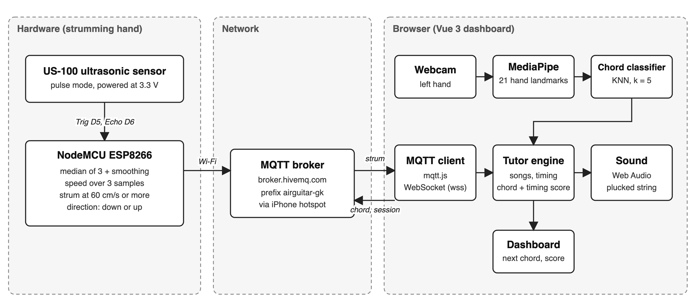

# Air Guitar

Course project for 953362 IoT and Embedded Programming by Virawit Kongthong (672115045).

## Introduction

An air guitar that lets you try playing a guitar without owning one. You show a chord shape to the webcam with your left hand and strum over an ultrasonic sensor with your right. A web dashboard plays the sound and shows the chords of a song, with a score for your chords and timing if you want to play along.

## Purpose

Trying guitar needs an instrument, and most people never get the chance to hold one. This project lets anyone play along to a song with a cheap sensor board, a webcam and a laptop. The IoT part is that the board sends every strum over Wi-Fi to the dashboard through MQTT.

## Tech stack

- Hardware: NodeMCU ESP8266, US-100 ultrasonic sensor, cardboard guitar body
- Firmware: Arduino C++ (ESP8266 core), PubSubClient
- Messaging: MQTT on the public broker.hivemq.com
- Web app: Vue 3, Vite, mqtt.js
- Chord recognition: MediaPipe Hand Landmarker and a k-nearest-neighbours classifier in plain JavaScript
- Sound: Web Audio (plucked string synth)

## How it works



1. **Strums.** The US-100 points out of the sound hole. Every 25 ms the NodeMCU reads the distance, takes a median of three readings, smooths it and works out the hand speed. A speed of 60 cm/s or more is a strum, and the sign of the speed gives the direction. It publishes `{"dir":"down","speed":42.5,"t":123456}` on `airguitar-gk/strum`.
2. **Chords.** In the browser, MediaPipe finds 21 landmarks on the left hand. The 210 distances between them, divided by hand size, go into a KNN classifier (k = 5) with a majority vote over the last 7 frames. Chords are C, G, Am, F, Em, Dm plus idle.
3. **Tutor.** When a strum arrives the dashboard plays the current chord, loudness from strum speed, and scores chord and timing against the song.

Wiring: VCC to 3V3, Trig to D5, Echo to D6, GND to GND. The sensor runs at 3.3 V so no voltage divider is needed, and its mode jumper stays off.

## Run it

Firmware (needs `arduino-cli` with the esp8266 core):

```
cd firmware/strum_firmware
cp secrets.example.h secrets.h
cd ..
./flash.sh strum_firmware
```

Fill in your hotspot name and password in `secrets.h` first. The ESP8266 only joins 2.4 GHz networks, so turn on Maximize Compatibility on an iPhone hotspot. The blue LED blinks fast while it connects and stays on once it is online.

Web app:

```
cd web
npm install
npm run dev
```

Open http://localhost:5173 in Chrome and press Start. Record about 50 samples per chord in the Train tab (they are saved to `web/data/training.json` while the dev server runs), then pick a song in the Tutor tab. Without the board, Space is a down strum and Arrow Up is an up strum. `npm test` runs the classifier tests.

## Results

- Chord classifier: 138 of 140 test frames correct (98.6%), same person and lighting as the training data.
- Strum to sound delay in the browser: 46 ms median, 55 ms worst of 40.
- Strum direction: in a counted trial of 20 down and 20 up strums, 74 of 157 messages (47%) had the intended direction. Each strum gave about four messages because the returning hand also counts as a strum. One sensor is the likely limit, so a second one is the next step.

Raw numbers and charts are in `docs/results` and `docs/charts`.

## Repo layout

```
firmware/
  strum_firmware/   board code (copy secrets.example.h to secrets.h)
  tests/            sensor test sketches
  flash.sh          compile and upload helper
web/
  src/              Vue app (store.js holds the logic, lib/ has the classifier, audio and MQTT)
  tests/            classifier tests
  data/             saved training and test samples
docs/
  diagrams/         block diagram and strum flowchart
  charts/           confusion matrix and strum trial chart
  results/          evaluation data
  screenshots/      dashboard screenshots
```
